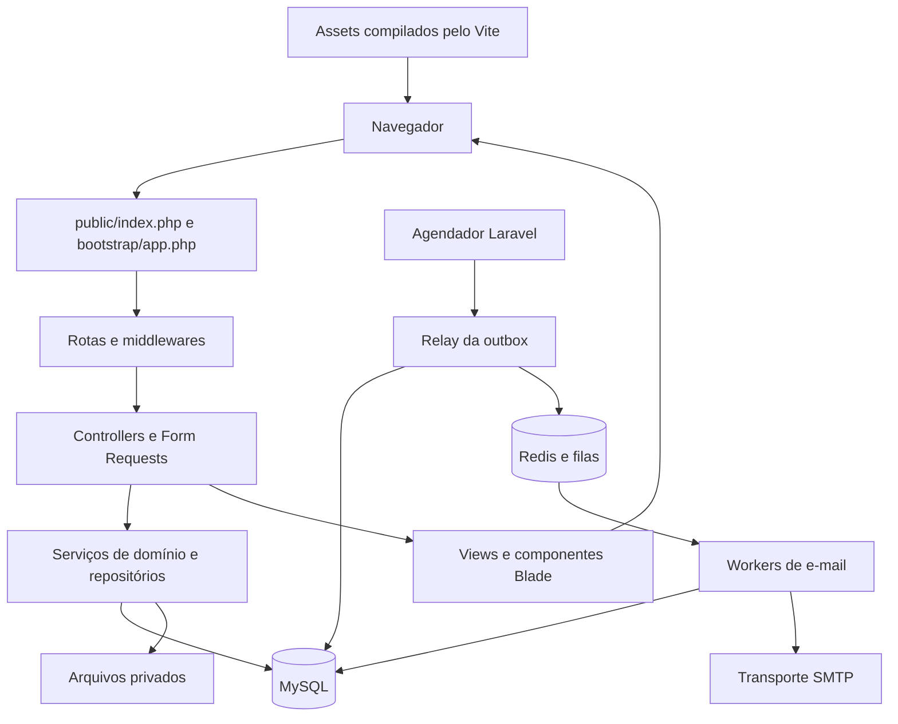

# Arquitetura do sistema

## Visão geral

Frota · PF é uma aplicação web monolítica em Laravel. Os módulos de negócio
compartilham a aplicação, a autenticação, os componentes Blade e o banco MySQL.
Os workers e o agendador executam o mesmo código em processos separados.

O servidor monta o HTML com Blade; JavaScript complementa formulários, modais,
mapas, WebAuthn e acompanhamento da sessão. As rotas de sessão e MFA também
trocam JSON. A interface não mantém uma cópia autônoma do domínio no navegador.

## Camadas e responsabilidades

| Camada              | Implementação                                           | Responsabilidade                                                            |
| ------------------- | ------------------------------------------------------- | --------------------------------------------------------------------------- |
| Entrada             | `public/index.php`, `artisan`, `bootstrap/`             | Inicializar o framework para HTTP ou console.                               |
| Contrato HTTP       | `routes/`, `app/Http/Middleware/`, `app/Http/Requests/` | Resolver endpoints, validar sessão, restringir acesso e validar entradas.   |
| Coordenação         | `app/Http/Controllers/`                                 | Escolher leituras e ações, chamar serviços e produzir respostas.            |
| Domínio             | `app/Services/`                                         | Executar fluxos, aplicar autorização, transações, concorrência e auditoria. |
| Persistência        | Query Builder, Eloquent e `database/sql/`               | Consultar dados e executar o contrato relacional e suas rotinas.            |
| Apresentação        | `resources/views/`, `resources/css/`, `resources/js/`   | Renderizar páginas e comportamentos da interface.                           |
| Execução assíncrona | `app/Jobs/`, comandos e `routes/console.php`            | Entregar mensagens e supervisionar processos fora da requisição web.        |

Os controllers recebem serviços por injeção de dependência. Os Form Requests
descrevem entradas e verificações de autorização da ação; os serviços voltam a
verificar os registros e o alcance necessários à operação. O banco complementa
essas regras com constraints, triggers e procedures.

## Fluxo de uma requisição

1. O Apache encaminha a requisição para `public/index.php`, que carrega o
   autoload e a aplicação definida em `bootstrap/app.php`.
2. `routes/web.php` identifica a rota, seus parâmetros e middlewares. O grupo
   web do Laravel fornece sessão, cookies, proteção CSRF e tratamento de erros.
3. Nas áreas autenticadas, `ValidateFleetSession` confere a identidade, a sessão
   de negócio e o vínculo. `RequireProfile`, `RequireFleetMfa` e
   `RequireEnabledRoute` acrescentam as restrições dos grupos que os utilizam.
4. O controller consulta um repositório ou encaminha a entrada validada ao
   serviço do módulo. Filtros, paginação e projeções são aplicados no servidor.
5. A resposta é uma view Blade, redirecionamento, JSON ou download autorizado.
   `PrivateResponse` e o tratamento global de exceções definem cabeçalhos de
   privacidade e respostas adequadas às falhas.

As rotas de status e reautenticação têm um caminho reduzido: preservam a
validação de identidade e revogação, mas dispensam dados usados apenas para
montar páginas. Consultar o status não registra atividade do usuário.

## Identidade, sessão e autorização

`User` adapta a tabela `usuarios` ao mecanismo de autenticação do Laravel.
`FleetUserProvider` integra a verificação de senha e a recuperação da identidade.
`PasswordPolicy` centraliza a política de senhas; `PasswordVerifier` faz a
verificação, geração e avaliação de rehash dos hashes.

Há duas estruturas de sessão relacionadas: a sessão HTTP do Laravel e a sessão
de negócio em `sessoes`. `FleetSession` cria um token aleatório, mantém seu hash
no banco e associa o contexto ao usuário e ao vínculo selecionado. A validade
considera inatividade, prazo para confirmar novamente a senha e duração máxima.
A reautenticação gira os identificadores e tokens sem recuperar uma sessão já
expirada ou revogada.

`AccessContext` é registrado com escopo de requisição. Sua matriz usa módulo,
ação e alcance: `0` sem acesso, `1` próprios registros, `2` unidade e `3` órgão.
A projeção de valores financeiros e localização possui verificações próprias.
`RequestAccessReader` reúne permissões e ativação das rotas em uma leitura
quando o endpoint precisa das duas informações. Esse contexto não sobrevive à
requisição, permitindo que mudanças de acesso sejam observadas nas seguintes.

`FleetMfa` e `WebAuthnVerifier` implementam desafios e validação WebAuthn para
sessões administrativas. A confirmação é vinculada à sessão HTTP, ao vínculo e
à versão de segurança da identidade. A recuperação administrativa usa um fluxo
de solicitação e aprovações. A possibilidade de pausar a exigência está limitada
ao ambiente `local`; a implementação continua presente nos demais ambientes.

`IdentityService` coordena ativação, recuperação de acesso, confirmação e troca
de e-mail, alteração de senha, invalidação de estados e avisos de segurança.
`SecurityAudit` registra eventos sem incluir credenciais ou tokens de acesso.

## Módulos de negócio

| Área          | Componentes centrais                                                 | Papel no sistema                                                               |
| ------------- | -------------------------------------------------------------------- | ------------------------------------------------------------------------------ |
| Solicitações  | `SolicitacoesController`, `RequestReadRepository`, `RequestWorkflow` | Rascunhos, revisões, passageiros, locais, anexos, envio e decisões do gestor.  |
| Viagens       | `TripController`, `TripWorkflow`, `OperationalReadRepository`        | Saída, retorno, vistorias, ocorrências e ações disponíveis ao motorista.       |
| Frota         | `VehicleController`, `VehicleWorkflow`                               | Cadastro, alterações, bloqueios de período e liberação manual de veículos.     |
| Agenda        | `AgendaController` e componentes de calendário/reserva               | Consultar ocupações e apresentar detalhes e percursos de reservas autorizadas. |
| Monitoramento | `MonitoringController`, `MonitoringReportRepository`                 | Leituras de posições, histórico e rotas aprovadas dentro do alcance permitido. |
| Financeiro    | `FinanceController`, `FinanceService`, `TyreController`              | Despesas, pagamentos, abastecimentos, manutenção e ciclo de pneus.             |
| Multas        | `FineController`, `FineWorkflow`                                     | Autuação, responsabilização, comprovantes, conferência e mudança de situação.  |
| Chamados      | `TicketController`, `TicketService`                                  | Abertura, mensagens, atendimento, atribuição e anexos privados.                |
| Notificações  | `NotificationController`, `NotificationStateService`                 | Listagem por destinatário, marcação de leitura e ocultação.                    |
| Relatórios    | `ReportController`, `ReportExportService`, `ReportPdfRenderer`       | Seleção de campos, prévia e geração de CSV ou PDF privado.                     |
| Administração | `AdminController`, `AdminWorkflow`, `AdminReadRepository`            | Usuários, vínculos, perfis, delegação de permissões e rotas habilitadas.       |
| Configuração  | `ConfigurationController`                                            | Alteração auditada das configurações operacionais autorizadas.                 |

`config/screens.php` descreve tabelas/views de leitura, colunas, módulos,
ações, filtros e campos adicionais de relatório. `FleetReadRepository` aplica
esse catálogo à consulta genérica. `OperationCatalog` resolve quais ações podem
ser oferecidas para um registro. Telas com fluxos próprios usam controllers e
views especializados, mantendo o contexto de autorização compartilhado.

O arquivo `app/Models/Solicitacao.php` é um adaptador de compatibilidade marcado
como obsoleto: estende `RequestReadRepository`. Ele não representa um modelo
Eloquent para gravar solicitações. A escrita fica em `RequestWorkflow`.

## Banco e consistência

O contrato relacional está em `database/sql/frota_pf_mysql.sql`. O diretório
`baselines/` guarda a base inicial e `patches/` contém a evolução incremental.
`manifest.json` registra a assinatura do SQL, inventários e metadados usados
pela ferramenta de verificação do esquema.

O banco modela identidade, vínculos, permissões, frota, solicitações e revisões,
reservas, viagens, arquivos, operações financeiras, multas, chamados,
notificações, exportações e auditoria. Views como `vw_permissoes_efetivas`,
`vw_solicitacoes_atuais` e `vw_frota` fornecem contratos de leitura.

Os serviços combinam transações e Query Builder com chamadas a procedures.
`ProcedureRunner` limita os nomes de rotinas permitidas, usa parâmetros
vinculados via PDO e consome os conjuntos de resultados da chamada. Regras
críticas podem, portanto, ser verificadas tanto pelo serviço quanto pelo SQL.
Campos de versão e bloqueios de linha protegem operações concorrentes nos
fluxos que os utilizam.

`DashboardReadRepository` reúne agregados de indicadores; os repositórios de
detalhes reutilizam um registro já autorizado para consultar seus filhos.
`ReferenceReadRepository` e os repositórios especializados carregam as opções
exigidas pelo formulário atual. O objetivo dessa divisão é reduzir consultas
sem manter permissões antigas entre requisições.

`database/seeders/DatabaseSeeder.php` não cria dados institucionais. A estrutura
do domínio é administrada pelo SQL versionado e pelos scripts de banco.
`fleet:check-schema`, chamado pelo entrypoint da imagem, verifica os contratos
de versão exigidos antes da execução normal; ele não aplica patches.

## Filas, e-mail e agendamento

A outbox durável fica na tabela MySQL `email_outbox`. `DispatchPendingMail`
seleciona entregas disponíveis, estabelece uma reserva temporária e publica
jobs nas filas Redis `auth-mails` ou `security-mails`. Os jobs carregam o
identificador da outbox, evitando transportar a mensagem inteira na fila.

`OutboxDelivery` revalida elegibilidade e estado, controla a reserva de envio,
chama o transporte SMTP e registra aceitação, reagendamento ou falha final.
Dados sensíveis de entrega permanecem cifrados enquanto necessários. A
aceitação SMTP e a persistência no MySQL são etapas distintas; uma repetição
após falha não equivale a uma garantia de envio exatamente uma vez.

`routes/console.php` agenda o relay e a supervisão das filas. Os comandos de
saúde verificam atraso, falhas, pressão de memória e sinais de vida dos
processos. Redis participa de filas, cache e coordenação; os registros
institucionais e a outbox permanecem no MySQL.

## Arquivos, relatórios e interface

`PrivateFileService` valida tipo e tamanho de upload, calcula SHA-256, gera uma
chave de armazenamento e relaciona os metadados à identidade autenticada. Os
controllers de cada módulo autorizam o vínculo do arquivo ao registro e seu
download. A localização física padrão é o disco local privado configurado em
`config/filesystems.php`.

`ReportExportService` prepara registros e campos de exportação, gera o formato
selecionado e registra o arquivo privado. O acesso é conferido novamente ao
obter o resultado. `ReportPdfRenderer` usa Dompdf e a view `reports/pdf.blade.php`,
com carregamento remoto, PHP embutido e JavaScript desabilitados no renderizador.

`resources/js/app.js` coordena a interação geral; `session.js` sincroniza o
acompanhamento e a confirmação de senha entre abas; `webauthn.js` converte os
dados e invoca a API de credenciais do navegador. Estado local de tema e
coordenação entre abas não concede permissões no servidor.

Os componentes de mapas atendem finalidades diferentes. A busca de locais usa
a URL configurável de geocodificação, cujo padrão é Photon, com seleção
geográfica apresentada no formulário. Percursos aprovados e reservas usam
dados do domínio. `simulated-monitoring-map.blade.php` apresenta viaturas
simuladas em movimento e não representa ingestão de telemetria real.

## Execução e qualidade

O Dockerfile separa dependências PHP, compilação de assets, runtime de produção
e runtime de desenvolvimento. A imagem de desenvolvimento inclui ferramentas
como Debugbar; a imagem padrão utiliza o conjunto de produção.

`docker-compose.yml` define aplicação, Redis, workers, scheduler e serviços
opcionais de administração e manutenção. O override acrescenta o ambiente de
desenvolvimento e o Vite; `compose.local.yml` adapta a execução ao banco local
com dados fictícios. `scripts/dev-remote.sh` verifica o alvo configurado antes
de iniciar o desenvolvimento com o banco remoto.

As configurações Laravel são divididas por assunto em `config/`. Exemplos de
ambiente ficam na raiz, enquanto valores privados pertencem à configuração da
instalação. O sistema de logs e o coletor de Debugbar evitam registrar bindings
sensíveis em sua telemetria de banco.

Os testes PHP separam unidades, páginas, autorização, fluxos e contratos MySQL.
As fixtures montam o cenário de cada suíte; o contrato de procedures e triggers
é exercitado por um ambiente descartável próprio. Testes Python verificam a
ferramenta de manutenção, e scripts de navegador cobrem interações da interface.
O workflow verifica dependências, formatação, análise estática, testes, build
frontend e imagem Docker. Prettier formata Blade e assets; Laravel Pint formata
o PHP da aplicação.

Consulte a [estrutura de pastas](ESTRUTURA.md) para localizar cada camada e o
[catálogo de arquivos](ARQUIVOS.md) para suas responsabilidades individuais.
