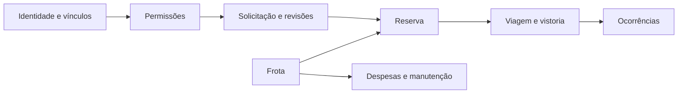

# Banco remoto

Os metadados foram consultados em 09/11/2026, às 15h43min58s, no fuso America/Manaus, por meio de PDO, em sessão configurada para somente leitura. A consulta abrangeu information_schema e não acessou registros operacionais.

| Objeto | Quantidade |
|---|---:|
| Tabelas físicas | 76 |
| Views | 14 |
| Colunas de tabelas e views | 909 |
| Componentes de chaves estrangeiras | 212 |
| Rotinas | 42 |
| Triggers | 124 |

Servidor: `11.8.9-MariaDB-log`. A contagem de componentes de chaves estrangeiras (FKs) não corresponde necessariamente à quantidade de restrições: uma chave composta pode ocupar várias linhas no resultado. O inventário de 16/10/2026 retrata uma coleta anterior.

## Organização e relações

A autorização utiliza os dados de identidade e os vínculos dos usuários. As solicitações mantêm revisões, enquanto reservas e viagens registram o atendimento. Vistorias e ocorrências documentam a execução; despesas e suas especializações registram os custos. Arquivos privados e auditoria atendem a vários módulos. Consulte o dicionário para identificar as relações físicas entre as tabelas.

Este diagrama é conceitual. Suas setas indicam dependências entre áreas do sistema; as chaves estrangeiras físicas estão descritas no dicionário.

## Como consultar

[Dicionário](DICIONARIO.md) descreve tipos, nulabilidade, defaults e relações atuais. [Objetos SQL](OBJETOS-SQL.md) contém definições retornadas para views, rotinas e triggers.

---
[Voltar ao índice](README.md)
